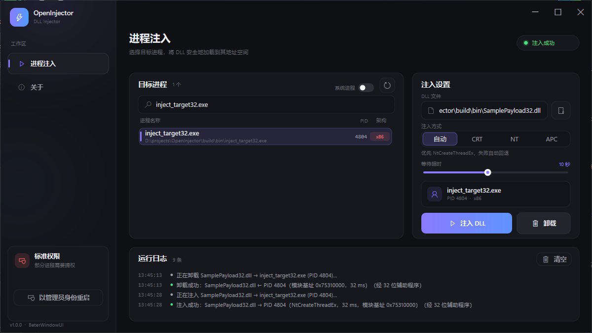

# OpenInjector

Windows DLL 注入器，包含 x64 图形界面 **OpenInjector.exe** / 命令行工具 **OpenInjectorTool.exe**、x86 原生图形界面 **OpenInjector32.exe** / 命令行工具 **OpenInjectorTool32.exe**，以及供 x64 版本调用的 32 位辅助程序 **OpenInjectorHelper32.exe**。
界面使用 [`library/`](library/) 中的 **BeterWindowUI**（Win32 + Direct2D + DirectWrite）构建。

> **仅限授权的安全测试、调试与教学用途。**
> 请只在你拥有或已获得明确授权的进程上使用本工具。使用者需自行承担相关责任。



## 功能

- 四种注入方式：自动、`CreateRemoteThread`、`NtCreateThreadEx`、`APC`
- 自动校验 DLL 与目标进程的位数；x64 注入器可经 32 位辅助程序注入 x86 目标
- x86 原生 GUI / CLI 可直接运行在 32 位 Windows 上，并直接注入 x86 目标进程
- 进程列表、名称/路径/PID 搜索、系统进程显示开关、手动刷新
- 选择、浏览或直接拖入 DLL；可调等待超时（2–20 秒）
- 后台线程执行注入，界面保持响应
- 卸载 DLL（远程 `FreeLibrary`）
- 启动挂起进程并注入（CLI `--launch`）
- 自动启用 `SeDebugPrivilege`；普通权限下提供 UAC 提权重启按钮
- CLI 支持文本/JSON 输出，便于脚本集成
- Per-Monitor V2 DPI、无边框窗口、深色主题和版本资源

## 构建

### 环境要求

- Windows 10 / 11 x64
- CMake ≥ 3.20
- MinGW-w64 GCC（需要 `g++`、`windres`、`mingw32-make`）
- 建议使用 **w64devkit**：其 multilib 支持 `-m32`，可同时生成 64 位主程序、x86 原生注入器和 32 位辅助程序
- 已在 **w64devkit GCC 16.2.0 + CMake 4.4.4 + MinGW Makefiles** 下验证

> 配置阶段会自动检测 `-m32`。如果工具链不支持 32 位，构建会跳过
> `OpenInjector32.exe`、`OpenInjectorTool32.exe`、`OpenInjectorHelper32.exe` 和 x86 测试目标，
> x64 GUI/CLI 仍可正常构建，但无法注入 x86 进程。

### 一键构建

```bat
build.bat
```

清理后重新构建：

```bat
build.bat clean
build.bat
```

### 手动构建

```bat
cmake -S . -B build -G "MinGW Makefiles" -DCMAKE_BUILD_TYPE=Release
cmake --build build --parallel
```

默认会同时构建测试目标。只构建 GUI 和 CLI：

```bat
cmake -S . -B build -G "MinGW Makefiles" -DCMAKE_BUILD_TYPE=Release -DOPENINJECTOR_BUILD_TESTS=OFF
```

### 产物

```text
build/
├─ bin/
│  ├─ OpenInjector.exe             GUI（x64）
│  ├─ OpenInjectorTool.exe         CLI（x64）
│  ├─ OpenInjector32.exe           GUI（x86 原生）
│  ├─ OpenInjectorTool32.exe       CLI（x86 原生）
│  ├─ OpenInjectorHelper32.exe     32 位注入辅助程序
│  ├─ Kacyo.BeterWindow.UI.dll     x64 GUI 依赖的 BeterWindowUI
│  ├─ Kacyo.BeterWindow.UI32.dll   x86 GUI 依赖的 BeterWindowUI
│  ├─ inject_target.exe            测试目标进程（x64）
│  ├─ inject_target32.exe          测试目标进程（x86）
│  ├─ SamplePayload.dll            测试载荷（x64）
│  └─ SamplePayload32.dll          测试载荷（x86）
└─ lib/
   ├─ liboi_core.a                 注入核心静态库（x64）
   └─ liboi_core32.a               注入核心静态库（x86）
```

> `OpenInjector.exe` 需要与 `Kacyo.BeterWindow.UI.dll` 放在同一目录；
> `OpenInjector32.exe` 需要与 `Kacyo.BeterWindow.UI32.dll` 放在同一目录。
> 需要从 x64 版本注入 x86 目标时，还必须把 `OpenInjectorHelper32.exe` 放在同一目录（或通过
> `OPENINJECTOR_HELPER32` 环境变量指定路径）。分发时请一起打包。

## GUI 用法

1. 启动 `OpenInjector.exe`。左下角显示当前权限；普通权限下部分受保护进程无法注入。
2. 在左侧搜索框中输入进程名、路径或 PID，选择目标进程。
3. 选择 DLL：
   - 点击 DLL 输入框手动输入路径；
   - 点击右侧文件夹按钮浏览；
   - 或直接从资源管理器拖入窗口。
4. 选择注入方式和等待超时，点击 **注入 DLL**。
5. 状态栏和运行日志会显示结果、实际使用的方式、耗时和远程模块基址。
6. 需要从目标进程卸载时点击 **卸载**。

如果目标是 x86 进程，x64 的 GUI 会自动调用同目录的 `OpenInjectorHelper32.exe`，
日志中会标注“经 32 位辅助程序”。DLL 的位数必须与目标进程一致。

### x86 原生界面

`OpenInjector32.exe` 是 32 位原生界面，可直接在 32 位 Windows 上运行，也可在 64 位 Windows 上直接注入 x86 进程。它与 x64 版共用同一套界面与核心源码，快捷键、拖放和后台注入行为一致，但需要同目录的 `Kacyo.BeterWindow.UI32.dll`。

x86 注入器无法创建 x64 远程线程，因此不能注入 x64 目标；需要注入 x64 进程时请使用 x64 版 `OpenInjector.exe`。

### 快捷键

| 操作 | 快捷键 |
| --- | --- |
| 刷新进程列表 | `F5` |
| 聚焦搜索框 | `Ctrl + F` / `Tab` |
| 聚焦 DLL 输入框 | `Ctrl + L` |
| 注入 | `Enter` |
| 切换输入框 | `Tab` |
| 取消输入焦点 / 清空搜索 | `Esc` |
| 双击进程行 | 选择该进程并立即注入 |

普通权限时，可点击左下角 **以管理员身份重启**。程序会通过 UAC 启动新的管理员实例并退出当前实例。

## CLI 用法

```text
OpenInjectorTool --list [--filter <文本>] [--json]
OpenInjectorTool --inject <DLL> --pid <PID> [选项]
OpenInjectorTool --inject <DLL> --name <进程名> [选项]
OpenInjectorTool --launch <程序> [--args <参数>] --inject <DLL> [选项]
OpenInjectorTool --eject <DLL> --pid <PID>
```

`OpenInjectorTool32.exe` 是 x86 原生版本，参数与 `OpenInjectorTool.exe` 完全一致，可在 32 位 Windows 上直接使用，也可在 64 位 Windows 上直接注入 x86 目标；它不能注入 x64 目标。

常用选项：

| 选项 | 说明 |
| --- | --- |
| `-l, --list` | 列出进程 |
| `-f, --filter <文本>` | 按进程名、路径或 PID 过滤 |
| `-d, --inject <DLL>` | 要注入的 DLL（也可写作 `--dll`） |
| `-p, --pid <PID>` | 目标 PID |
| `-n, --name <名称>` | 目标进程名，例如 `notepad.exe` |
| `-m, --method <方式>` | `auto`、`crt`、`nt`、`apc`，默认 `auto` |
| `-t, --timeout <毫秒>` | 等待超时，默认 `10000` |
| `--eject` | 从目标进程卸载 DLL |
| `--launch <程序>` | 以挂起状态启动程序并注入 |
| `--args <参数>` | 传给新进程的命令行参数 |
| `--wait` | 等待新进程退出（配合 `--launch`） |
| `--json` | 以 JSON 输出结果 |
| `-q, --quiet` | 仅输出错误 |
| `-h, --help` | 显示帮助 |
| `--version` | 显示版本与主机架构 |

### 示例

```bat
:: 查看记事本进程
OpenInjectorTool.exe -l -f notepad

:: 按 PID 注入，使用 NtCreateThreadEx
OpenInjectorTool.exe --inject C:\test\payload.dll --pid 1234 --method nt

:: 按进程名注入
OpenInjectorTool.exe --inject payload.dll --name notepad.exe

:: 注入 32 位目标（x64 CLI 自动调用 OpenInjectorHelper32.exe）
OpenInjectorTool.exe --inject C:\test\payload32.dll --pid 1234 --method nt

:: 启动挂起进程并注入，然后让它继续运行
OpenInjectorTool.exe --launch C:\Windows\System32\notepad.exe --inject C:\test\payload.dll

:: 卸载
OpenInjectorTool.exe --eject C:\test\payload.dll --pid 1234

:: JSON 输出
OpenInjectorTool.exe --inject payload.dll --pid 1234 --json
```

### 退出码

| 退出码 | 含义 |
| --- | --- |
| `0` | 成功 |
| `1` | 参数解析失败 |
| `2` | 注入/卸载/启动操作失败 |
| `3` | 目标进程不存在或无法访问 |

> 在 Windows PowerShell 5.1 中通过管道读取中文输出时，可先执行
> `[Console]::OutputEncoding = [System.Text.Encoding]::UTF8`，否则可能显示乱码。
> CLI 在重定向输出时使用 UTF-8。

## 注入方式

| 方式 | 实现 | 适用场景 |
| --- | --- | --- |
| `auto` | 先尝试 `NtCreateThreadEx`，失败后回退 `CreateRemoteThread` | 默认，兼容性与成功率最好 |
| `crt` | `CreateRemoteThread` + `LoadLibraryW` | 兼容性最高；可能被用户层 Hook 拦截 |
| `nt` | 直接调用 `ntdll!NtCreateThreadEx` + `LoadLibraryW` | 绕过用户层线程创建 Hook |
| `apc` | 向目标线程队列 `QueueUserAPC(LoadLibraryW)` | 目标线程必须进入可警告等待；成功率较低 |

所有方式都会：

1. 校验 DLL 与目标进程的架构；
2. 打开目标进程并分配远程内存；
3. 写入 DLL 的绝对路径；
4. 解析目标进程中 `kernel32!LoadLibraryW` 的实际地址；
5. 触发远程加载并等待模块出现；
6. 超时或参数不再被使用时安全清理。

卸载使用远程 `FreeLibrary`。如果 DLL 的引用计数仍大于 0，卸载会失败并返回错误。

## 位数与兼容性

| 注入器 | 目标进程 | 目标 DLL | 支持情况 |
| --- | --- | --- | --- |
| x64 GUI / CLI | x64 | x64 | 直接注入 |
| x64 GUI / CLI | x86（WOW64） | x86 | 自动调用 32 位辅助程序 |
| x86 原生 GUI / CLI | x86 | x86 | 直接注入（无需辅助程序） |
| x86 原生 GUI / CLI | x64 | x64 | 拒绝：x86 注入器无法创建 x64 远程线程 |
| x64 GUI / CLI | x86 | x64 | 拒绝：DLL 位数不匹配 |
| x64 GUI / CLI | x64 | x86 | 拒绝：DLL 位数不匹配 |
| x86 辅助程序 | x86 | x86 | 支持（内部使用） |
| x86 辅助程序 | x64 | x64 | 拒绝：x86 注入器无法创建 x64 远程线程 |

- 核心库始终校验 DLL 与目标进程的位数；DLL 位数未知时按目标进程处理。
- x64 → x86 时，核心库启动 `OpenInjectorHelper32.exe`，由它完成远程线程创建、APC 排队和模块加载确认。
- 辅助程序查找顺序：
  1. 环境变量 `OPENINJECTOR_HELPER32` 指向的文件（存在时）；
  2. 主程序同目录的 `OpenInjectorHelper32.exe`。
- 辅助程序通过临时 UTF-16LE 结果文件回传成功/失败、实际方式、模块基址和耗时，主程序不会解析控制台输出。
- x64 进程可以直接读写 x86 目标的内存，但远程线程必须与目标同位数，因此执行阶段必须交给 32 位 helper。
- x86 原生 GUI / CLI 与 x86 目标位数一致，直接完成注入，不依赖辅助程序；对 x64 目标会返回明确的位数不匹配错误。
- `OpenInjectorHelper32.exe` 只接受主程序生成的参数，不提供独立命令行界面。
- Protected Process Light（PPL）、受 EDR/反作弊保护的系统进程通常无法注入，即使拥有管理员权限。
- 目标进程必须能够访问 DLL 路径；网络路径可能受目标进程凭据限制。
- 提升权限的 GUI 无法接收来自普通权限资源管理器的拖放（Windows UIPI 限制），此时请使用文件浏览按钮。
- APC 方式依赖目标线程进入可警告等待；对没有可警告等待的进程可能超时。

## 测试

构建测试目标后：

x64 目标：

```bat
:: 终端 1：启动测试目标，记下 PID
build\bin\inject_target.exe

:: 终端 2：注入、检查标记、卸载
build\bin\OpenInjectorTool.exe --inject build\bin\SamplePayload.dll --pid <PID> --method nt
build\bin\OpenInjectorTool.exe --eject build\bin\SamplePayload.dll --pid <PID>
```

x86 目标（x64 CLI 会自动调用 32 位辅助程序）：

```bat
:: 终端 1：启动 32 位测试目标，记下 PID
build\bin\inject_target32.exe

:: 终端 2：注入、检查标记、卸载
build\bin\OpenInjectorTool.exe --inject build\bin\SamplePayload32.dll --pid <PID> --method nt
build\bin\OpenInjectorTool.exe --eject build\bin\SamplePayload32.dll --pid <PID>
```

x86 目标（x86 原生 CLI 直接注入）：

```bat
build\bin\OpenInjectorTool32.exe --inject build\bin\SamplePayload32.dll --pid <PID> --method nt
build\bin\OpenInjectorTool32.exe --eject build\bin\SamplePayload32.dll --pid <PID>
```

测试载荷会在 DLL 所在目录写入：

- `payload_loaded_<PID>.txt`
- `payload_unloaded_<PID>.txt`

自动化冒烟测试（PowerShell）：

```powershell
# x64
powershell -ExecutionPolicy Bypass -File tools\cli-smoke.ps1
powershell -ExecutionPolicy Bypass -File tools\gui-smoke.ps1

# x86（验证 x64 → 32 位 helper 分发）
powershell -ExecutionPolicy Bypass -File tools\cli-smoke.ps1 `
    -TargetExe inject_target32.exe -TargetName inject_target32 -Dll SamplePayload32.dll
powershell -ExecutionPolicy Bypass -File tools\gui-smoke.ps1 `
    -TargetExe inject_target32.exe -TargetName inject_target32 -Dll SamplePayload32.dll

# x86 原生版本（不经过 helper）
powershell -ExecutionPolicy Bypass -File tools\cli-smoke.ps1 `
    -TargetExe inject_target32.exe -TargetName inject_target32 -Dll SamplePayload32.dll `
    -ToolExe OpenInjectorTool32.exe
powershell -ExecutionPolicy Bypass -File tools\gui-smoke.ps1 `
    -TargetExe inject_target32.exe -TargetName inject_target32 -Dll SamplePayload32.dll `
    -GuiExe OpenInjector32.exe
```

- `cli-smoke.ps1` 依次验证 `crt`、`nt`、`apc`、启动并注入、卸载和错误处理。
- `gui-smoke.ps1` 通过窗口消息模拟真实点击，完成选择进程、输入 DLL、注入和卸载，并把截图保存到 `out/`。
- 两个脚本默认使用 `build\bin`，可用 `-BinDir` 指定其他输出目录；
  可用 `-TargetExe`、`-TargetName`、`-Dll` 切换 x64 / x86 测试场景；
  可用 `-ToolExe` / `-GuiExe` 指定 x86 原生版本进行测试。

## 项目结构

```text
src/
├─ core/                 注入核心（GUI 与 CLI 共用）
│  ├─ injector.h         公共 API
│  ├─ injector.cpp       四种注入、卸载、启动并注入
│  ├─ bridge.cpp         x64 → x86 辅助程序分发与结果解析
│  ├─ bridge_internal.h
│  ├─ remote.cpp         远程模块查找与 API 地址解析
│  ├─ remote_internal.h
│  └─ util.cpp           进程枚举、架构、PE 校验、权限、错误格式化
├─ helper/main.cpp       32 位注入辅助程序
├─ gui/                  BeterWindowUI 图形界面
│  ├─ main.cpp           窗口、DPI、消息循环
│  ├─ app.h / app.cpp    状态、输入、业务与后台任务
│  └─ draw.cpp           全部界面绘制与布局
├─ cli/main.cpp          命令行接口
└─ resources/            图标、清单、版本资源和 resource.h
tests/
├─ inject_target.cpp     可警告等待的测试目标（x64 / x86）
└─ sample_payload.cpp    写加载/卸载标记的测试 DLL（x64 / x86）
library/                 BeterWindowUI 源码与头文件
tools/                   截图、图标生成和冒烟测试脚本
docs/                    README 截图
```

## 实现概要

- 进程枚举使用 Toolhelp32；架构通过 `IsWow64Process2` 与 PE 头机器类型校验。
- 远程 `LoadLibraryW` 地址按“目标进程中的模块基址 + 导出表 RVA”解析，适配 ASLR。
- 注入后轮询目标模块列表，确认 DLL 已实际加载；失败时返回 Win32/NTSTATUS 错误文本。
- APC 方式会保留远程参数字符串的缓冲区，并清空首字符，避免排队后目标线程访问已释放内存。
- GUI 的注入/卸载在后台线程执行，完成后通过 `WM_APP + 1` 回到 UI 线程更新状态。
- x86 原生 GUI / CLI 复用同一套核心与界面源码，由 CMake 以 `-m32` 单独编译，
  并通过独立的 `Kacyo.BeterWindow.UI32.dll` 与 x64 版本共存于同一输出目录。
- x64 核心检测到 x86 目标时，用 `CreateProcessW(..., CREATE_NO_WINDOW)` 启动
  `OpenInjectorHelper32.exe`，传入 `--pid/--dll/--method/--timeout/--result`；
  helper 以 UTF-16LE 写入 `ok/error/method/base/elapsed/message` 字段，
  核心解析后转换为正常的 `InjectResult`，GUI/CLI 无需区分目标位数。

## 免责声明

本工具用于授权的安全测试、调试和教学。请勿用于未经授权的进程、规避安全产品或其他违法用途。
项目作者不对因使用本工具造成的任何直接或间接损失负责。
